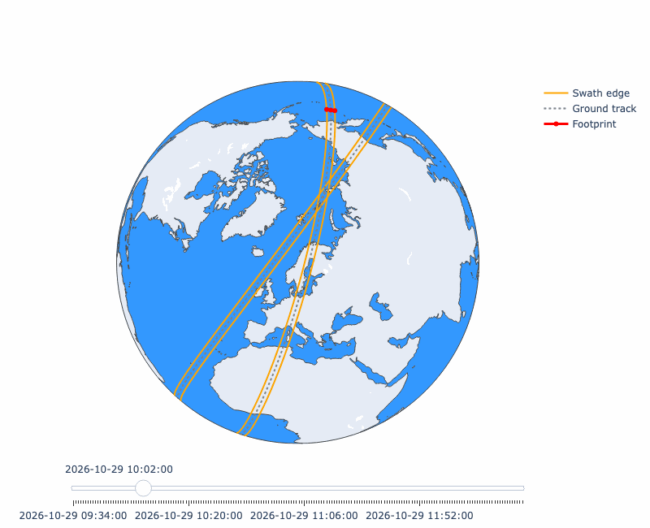

# swath-viewer

Plot a satellite's nadir swath over time, either on a plotly globe or in kepler.gl, with a time slider.



## Install

The project is managed with [uv](https://docs.astral.sh/uv/), a fast Python package and project manager that
installs Python itself, creates the virtual environment and keeps dependencies in sync with `uv.lock`.

```bash
# Install uv (or: brew install uv)
curl -LsSf https://astral.sh/uv/install.sh | sh

# Create .venv with Python 3.12 and the locked dependencies
cd swath_viewer
uv sync
```

`uv run` also syncs the environment, so running the command below works without the `uv sync` step.

## Input

- **TLE**: a file path or URL to a two-line element set. A name line above the two TLE lines is fine, so
  CelesTrak's `FORMAT=TLE` output works as is.
- **Swath width**: the full nadir footprint width in km. The swath is drawn half that width out to each side of
  the ground track.

The orbit is propagated from the current time, for `--hours` hours in steps of `--step-s` seconds.

## Usage

```bash
uv run plot_swath.py <tle_file_or_url> <swath_km> [--backend plotly|kepler] [--hours 3] [--step-s 60]
```

Examples:

```bash
# Sentinel-2B, 290 km swath, on a plotly globe
uv run plot_swath.py "https://celestrak.org/NORAD/elements/gp.php?CATNR=60989&FORMAT=TLE" 290

# Same in kepler.gl, 1 hour from now
uv run plot_swath.py "https://celestrak.org/NORAD/elements/gp.php?CATNR=60989&FORMAT=TLE" 290 --backend kepler --hours 1
```

- **plotly** opens an orthographic globe in the browser. The slider moves the current footprint along the swath.
- **kepler** writes `swath.html` to the current directory and opens it. The time filter is shown at the bottom;
  drag its window or press play to sweep the swath.

Both maps open centred on Norway.
